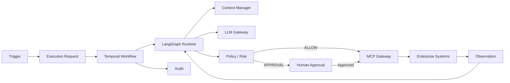

# Digital Employee Platform — Architecture Index

**Version:** 0.1.0  
**Status:** Normative baseline  
**Date:** 2026-09-21

## 1. Purpose

This directory is the architectural contract for the Digital Employee Platform: a B2B platform for building, deploying, governing and operating autonomous Digital Employees that execute business work through durable workflows, controlled tools and human governance.

The documents are intentionally layered. Product intent is separated from enterprise architecture, domain semantics, runtime behavior, security, integrations, context, operations and development rules.

## 2. Normative rule

> **Architecture documents are normative. Code must implement the architecture; it must not silently redefine it.**

A change that affects component boundaries, security boundaries, persistence, execution semantics, public contracts, deployment model or governance must be accompanied by an ADR or an explicit architecture revision.

## 3. Reading order

1. `01-PRODUCT-VISION.md` — what the product is.
2. `02-ENTERPRISE-ARCHITECTURE.md` — how the platform is structured.
3. `03-DOMAIN-MODEL.md` — what the business objects mean.
4. `04-RUNTIME-EXECUTION-ARCHITECTURE.md` — how work executes.
5. `05-PERSISTENCE-API-CONTRACTS.md` — durable state and interfaces.
6. `06-SECURITY-GOVERNANCE.md` — security and control model.
7. `07-MCP-INTEGRATION-ARCHITECTURE.md` — controlled enterprise capabilities.
8. `08-MEMORY-KNOWLEDGE-CONTEXT.md` — information and context lifecycle.
9. `09-OBSERVABILITY-EVALUATION.md` — operational visibility and quality.
10. `10-DEPLOYMENT-OPERATIONS.md` — deployment and production operations.
11. ADRs — immutable rationale behind important choices.
12. Development guides — rules for implementation agents and engineers.

## 4. Architecture principles

- **Execution is the unit of work.** A message, schedule or event creates an execution request; it does not directly execute agent code.
- **Triggers and channels are independent.** A scheduled task can send an email; an ERP event can create a ticket; a manual request can produce a Teams message.
- **Temporal owns durability.** Long-running state, retries, timers, cancellation, signals, recovery and human waits belong to the durable workflow layer.
- **LangGraph owns agent cognition.** Reasoning loops, stateful planning and tool-oriented agent behavior belong inside the agent runtime.
- **LLMs propose; deterministic controls authorize.** Model output is untrusted and never constitutes authorization.
- **MCP exposes capabilities; the MCP Gateway enforces access.** MCP is an integration protocol, not the security model.
- **Every external action is policy-checked and audited.**
- **Secrets never enter prompts, agent state, memory or ordinary logs.**
- **External content is data, not instructions.** Prompt injection is treated as an input-security problem.
- **PostgreSQL is the system of record for business/domain state; Temporal is the system of record for workflow state.**
- **Versioned definitions are immutable.** Executions retain the exact versions used.
- **Single-tenant deployment is the initial isolation model.** Dynamic multi-tenancy is not an MVP assumption.

## 5. Canonical runtime

## 6. Source-of-truth rules

| Concern | Authority |
|---|---|
| Product intent | `01-PRODUCT-VISION.md` |
| Component boundaries | `02-ENTERPRISE-ARCHITECTURE.md` |
| Domain semantics | `03-DOMAIN-MODEL.md` |
| Execution behavior | `04-RUNTIME-EXECUTION-ARCHITECTURE.md` |
| Persistence/API contracts | `05-PERSISTENCE-API-CONTRACTS.md` |
| Security/governance | `06-SECURITY-GOVERNANCE.md` |
| MCP behavior | `07-MCP-INTEGRATION-ARCHITECTURE.md` |
| Memory/context | `08-MEMORY-KNOWLEDGE-CONTEXT.md` |
| Observability/evaluation | `09-OBSERVABILITY-EVALUATION.md` |
| Operations | `10-DEPLOYMENT-OPERATIONS.md` |
| Architectural rationale | `docs/adr/` |
| Coding behavior | `docs/development/` |

## 7. Change process

1. Identify the affected architectural contract.
2. Determine whether the change is implementation detail or architectural.
3. For architectural changes, create/update an ADR before implementation.
4. Update affected documents and cross-references.
5. Add or update tests/evaluations.
6. Implement.
7. Record migration and rollback implications.

## 8. Non-goals of the baseline

The baseline does not require Kubernetes, Kafka, service mesh, dynamic multi-tenancy, a custom identity provider, a custom vector database, unrestricted browser automation, unrestricted shell access, or a universal MCP server.

These may be introduced later only when requirements justify them.

## 9. Definition of architectural consistency

An implementation is architecturally consistent when a reviewer can answer:

> Why did this Digital Employee perform this action, using which versions, with which information, under which policy, with which authorization, against which capability, and with what exact result?

If the platform cannot reconstruct that chain, the implementation is incomplete from a governance perspective.

## 10. Reference documents (non-normative)

These documents do not define the architecture; they support it and are the evidence base for changes:

| Document | Purpose |
|---|---|
| `RUNTIME-EXECUTION-FULL-ANNEX-ARCHITECTURE-03.md` | Legacy operational detail; **superseded**, kept for implementation reference |
| `SPIKE-FASE1-FOUNDATION-investigacion.md` | Foundation-phase validation plan and GO/NO-GO thresholds |
| `KORTIX-analisis-y-licencias.md` | Independent assessment of Kortix/Suna as base vs reference, plus its licence |
| `KORTIX-INVESTIGACION-v0.14.3.md` | Capability investigation of Kortix/Suna at a pinned commit, with evidence and status per capability |
| `KORTIX-CROSS-MATRIX.md` | Document inventory, cross-check matrix, gaps, proposals and explicit discards |
| `STACK-LICENCIAS.md` | Licence inventory of the target stack with commercial risk classification |
| `REGISTRO-CAMBIOS-DOCUMENTALES-2026-10-19.md` | Traceability of the 2026-10-19 documentation changes |
| `DECISIONES-PENDIENTES.md` | Decisions that cannot be closed by documentary analysis alone |

Citation rule: the annex and the spike keep **legacy section numbers** (§64, §66, §89…) that do not exist in the normative documents. Always cite the normative document and section; treat legacy numbers as historical pointers only.

## 11. Documentation revision 2026-10-19

Additive revision. Sections were **extended**; no architectural principle, boundary, contract name or ADR was changed. Changes: `03` §5.1–5.2, §15 · `04` §2, §4, §11, §21–25 · `05` §1, §5.1–5.2, §10.1, §11, §20–22 · `06` §2.1–2.2, §4.1, §7.1, §17–18 · `07` §8.1 · `08` §13 · `09` §3, §6, §12.1, §13 · `10` §17–18. Rationale and evidence: `docs/reference/REGISTRO-CAMBIOS-DOCUMENTALES-2026-10-19.md`.
