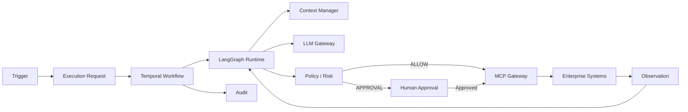

# Digital Employee Platform — Architecture Index

**Version:** 0.1.0  
**Status:** Normative baseline  
**Date:** 2026-09-21  
**Created:** 2026-09-21  
**Updated:** 2026-10-20

## 1. Purpose

This directory is the architectural contract for the Digital Employee Platform: a B2B platform for building, deploying, governing and operating autonomous Digital Employees that execute business work through durable workflows, controlled tools and human governance.

The documents are intentionally layered. Product intent is separated from enterprise architecture, domain semantics, runtime behavior, security, integrations, context, operations and development rules.

## 2. Normative rule

> **Architecture documents are normative. Code must implement the architecture; it must not silently redefine it.**

A change that affects component boundaries, security boundaries, persistence, execution semantics, public contracts, deployment model or governance must be accompanied by an ADR or an explicit architecture revision.

## 3. Reading order

1. `01-PRODUCT-VISION.md` — what the product is.
2. `02-ENTERPRISE-ARCHITECTURE.md` — how the platform is structured.
3. `03-DOMAIN-MODEL.md` — what the business objects mean.
4. `04-RUNTIME-EXECUTION-ARCHITECTURE.md` — how work executes.
5. `05-PERSISTENCE-API-CONTRACTS.md` — durable state and interfaces.
6. `06-SECURITY-GOVERNANCE.md` — security and control model.
7. `07-MCP-INTEGRATION-ARCHITECTURE.md` — controlled enterprise capabilities.
8. `08-MEMORY-KNOWLEDGE-CONTEXT.md` — information and context lifecycle.
9. `09-OBSERVABILITY-EVALUATION.md` — operational visibility and quality.
10. `10-DEPLOYMENT-OPERATIONS.md` — deployment and production operations.
11. ADRs — immutable rationale behind important choices.
12. Development guides — rules for implementation agents and engineers.

## 4. Architecture principles

- **Execution is the unit of work.** A message, schedule or event creates an execution request; it does not directly execute agent code.
- **Triggers and channels are independent.** A scheduled task can send an email; an ERP event can create a ticket; a manual request can produce a Teams message.
- **Temporal owns durability.** Long-running state, retries, timers, cancellation, signals, recovery and human waits belong to the durable workflow layer.
- **LangGraph owns agent cognition.** Reasoning loops, stateful planning and tool-oriented agent behavior belong inside the agent runtime.
- **LLMs propose; deterministic controls authorize.** Model output is untrusted and never constitutes authorization.
- **MCP exposes capabilities; the MCP Gateway enforces access.** MCP is an integration protocol, not the security model.
- **Every external action is policy-checked and audited.**
- **Secrets never enter prompts, agent state, memory or ordinary logs.**
- **External content is data, not instructions.** Prompt injection is treated as an input-security problem.
- **PostgreSQL is the system of record for business/domain state; Temporal is the system of record for workflow state.**
- **Versioned definitions are immutable.** Executions retain the exact versions used.
- **Single-tenant deployment is the initial isolation model.** Dynamic multi-tenancy is not an MVP assumption.

## 5. Canonical runtime

## 6. Source-of-truth rules

| Concern | Authority |
|---|---|
| Product intent | `01-PRODUCT-VISION.md` |
| Component boundaries | `02-ENTERPRISE-ARCHITECTURE.md` |
| Domain semantics | `03-DOMAIN-MODEL.md` |
| Execution behavior | `04-RUNTIME-EXECUTION-ARCHITECTURE.md` |
| Persistence/API contracts | `05-PERSISTENCE-API-CONTRACTS.md` |
| Security/governance | `06-SECURITY-GOVERNANCE.md` |
| MCP behavior | `07-MCP-INTEGRATION-ARCHITECTURE.md` |
| Memory/context | `08-MEMORY-KNOWLEDGE-CONTEXT.md` |
| Observability/evaluation | `09-OBSERVABILITY-EVALUATION.md` |
| Operations | `10-DEPLOYMENT-OPERATIONS.md` |
| Architectural rationale | `docs/adr/` |
| Coding behavior | `docs/development/` |

## 7. Change process

1. Identify the affected architectural contract.
2. Determine whether the change is implementation detail or architectural.
3. For architectural changes, create/update an ADR before implementation.
4. Update affected documents and cross-references.
5. Add or update tests/evaluations.
6. Implement.
7. Record migration and rollback implications.

## 8. Non-goals of the baseline

The baseline does not require Kubernetes, Kafka, service mesh, dynamic multi-tenancy, a custom identity provider, a custom vector database, unrestricted browser automation, unrestricted shell access, or a universal MCP server.

These may be introduced later only when requirements justify them.

## 9. Definition of architectural consistency

An implementation is architecturally consistent when a reviewer can answer:

> Why did this Digital Employee perform this action, using which versions, with which information, under which policy, with which authorization, against which capability, and with what exact result?

If the platform cannot reconstruct that chain, the implementation is incomplete from a governance perspective.

## 10. Reference documents (non-normative)

These documents do not define the architecture; they support it and are the evidence base for changes:

| Document | Purpose |
|---|---|
| `RUNTIME-EXECUTION-FULL-ANNEX-ARCHITECTURE-03.md` | Legacy operational detail; **superseded**, kept for implementation reference |
| `SPIKE-FASE1-FOUNDATION-investigacion.md` | Foundation-phase validation plan and GO/NO-GO thresholds |
| `KORTIX-analisis-y-licencias.md` | Independent assessment of Kortix/Suna as base vs reference, plus its licence |
| `KORTIX-INVESTIGACION-v0.14.3.md` | Capability investigation of Kortix/Suna at a pinned commit, with evidence and status per capability |
| `KORTIX-CROSS-MATRIX.md` | Document inventory, cross-check matrix, gaps, proposals and explicit discards |
| `STACK-LICENCIAS.md` | Licence inventory of the target stack with commercial risk classification |
| `REGISTRO-CAMBIOS-DOCUMENTALES-2026-10-19.md` | Traceability of the 2026-10-19 documentation changes |
| `REGISTRO-CAMBIOS-2026-10-19-AUDITORIA.md` | Traceability of the 2026-10-19 consistency audit (file, section, reason, before/after state, validation) |
| `AUDITORIA-CONSISTENCIA-2026-10-19.md` | Consistency audit report: scope, findings by severity, exact evidence, changes made and risks still open |
| `INVARIANTES-Y-PRUEBAS.md` | Architectural invariants with their normative source, the risk they prevent, the test required, its current state and the phase in which it must run |
| `REGISTRO-CAMBIOS-2026-10-19-ADR-011-ACEPTADO.md` | Change log for the acceptance of `ADR-011` and the normative component renames it enabled |
| `VERIFICACION-POST-AUDITORIA-2026-10-19.md` | Post-audit verification report (state of the published files, reusable-code question, open risks) |
| `REGISTRO-CAMBIOS-2026-10-19-VERIFICACION-POST-AUDITORIA.md` | Change log for the post-audit verification (V-1…V-8) |
| `REGISTRO-CAMBIOS-2026-10-19-DECISIONES-RESPONSABLE.md` | Change log for the product-owner decisions of 2026-10-19 (`ADR-012`–`ADR-014`, DP-1/DP-2/DP-5/DP-6/DP-18/DP-19/DP-20, validators published and wired into CI) |
| `COMPATIBILIDAD-Y-LICENCIAS-PREPARACION.md` | Preparation of the compatibility tests and the licence review of the distributable artifact: verified reference versions, uses to test, deliverables and risks |
| `DECISIONES-PENDIENTES.md` | Decisions that cannot be closed by documentary analysis alone |

### Proposed MVP product documents (2026-10-20)

The proposed product package lives in `docs/product/` with Spanish reading mirrors in `docs/es/product/`: `MVP-PRD.md`, `MVP-DELIVERY-PLAN.md` and `MVP-TRACEABILITY-MATRIX.md`. It narrows the first demonstrator to one Collections Digital Employee, a minimal first-party web console, synthetic data, a simulated integration, durable human approval and measurable acceptance tests. **This is not an accepted product scope**: Collections and the first channel remain recommendations until the product owner accepts them; DP-3 stays open. The proposal does not change architecture or ADRs and does not close technical, licence or legal gates. Record: `docs/reference/REGISTRO-MVP-DEFINITION-2026-10-20.md`.

Citation rule: the annex and the spike keep **legacy section numbers** (§64, §66, §89…) that do not exist in the normative documents. Always cite the normative document and section; treat legacy numbers as historical pointers only.

## 11. Documentation revision 2026-10-19

Additive revision. Sections were **extended**; no architectural principle, boundary, contract name or ADR was changed. Changes: `03` §5.1–5.2, §15 · `04` §2, §4, §11, §21–25 · `05` §1, §5.1–5.2, §10.1, §11, §20–22 · `06` §2.1–2.2, §4.1, §7.1, §17–18 · `07` §8.1 · `08` §13 · `09` §3, §6, §12.1, §13 · `10` §17–18. Rationale and evidence: `docs/reference/REGISTRO-CAMBIOS-DOCUMENTALES-2026-10-19.md`.

## 12. Consistency audit 2026-10-19

Second revision of the same day: an **audit** of the package rather than an extension of it. No architectural decision was changed and no dependency was added.

- **Corrected:** package counts and inventories (`00-INDEX.md` said 26 files and cited a wrong manifest path; the cross matrix said 62 files; the Spanish mirror of the manifest was stale), metadata traceability (`Created`/`Updated` on the 11 architecture documents and the 5 development guides; `Date` on the 11 ADRs; frontmatter on the reference documents).
- **Clarified:** the durability boundary in `04` §21.2 (the five notions — cognitive run, durable human wait, workflow recovery, failed activity, business results — are now an explicit table); read-versus-command in `04` §22; Temporal patching and worker cutover in `04` §24; the commercial modalities separated from the architectural limit in `01` §7.1.
- **Annotated, not substituted (at the time of the audit):** the components named in `02` §4, `05` §1, `09` §2 and `00-INDEX.md` carried an explicit "outgoing / reference substitute, pending formal acceptance of `ADR-011`" note. No component was silently renamed and no dependency was introduced. **Superseded hours later by the acceptance (see §13).**
- **Separated:** `ADR-011` now states its five formalisation layers (product decision, formal acceptance, technical compatibility, licence verification, legal validation) instead of implying that one closes the next.
- Findings, evidence and open risks: `docs/reference/AUDITORIA-CONSISTENCIA-2026-10-19.md`. Change-by-change trace: `docs/reference/REGISTRO-CAMBIOS-2026-10-19-AUDITORIA.md`. Tests still owed: `docs/reference/INVARIANTES-Y-PRUEBAS.md`.

## 13. `ADR-011` acceptance 2026-10-19

Third revision of the same day: the product owner **accepted `ADR-011`** (`Proposed` → `Accepted`). The free-licence policy became a normative rule of the package and the substitution stopped being an annotation:

- **Renamed (normative):** `OpenBao` replaces `Vault`/`Vault-KMS` in `02` §4 (table and diagram), `04` (credential diagram), `06` §7, `07` (MCP diagram), `10` §1–§3 and the `ADR-007` implementation note; `Valkey` replaces `Redis` in `00-INDEX.md`, `02` §4, `05` §1 and `10` §1; `Perses` replaces `Grafana` and `VictoriaLogs`/`OpenSearch` replace `Loki` in `09` §2; `SeaweedFS` remains the reference for object storage. Spanish mirrors and `EXPLICACION-NO-TECNICA.md` updated in the same revision.
- **Unchanged by this act:** no architectural decision, no boundary, no contract name and no dependency. **No test was closed:** licence verification is not technical validation of a substitution (DP-5, DP-6 remain open).
- Trace: `docs/reference/REGISTRO-CAMBIOS-2026-10-19-ADR-011-ACEPTADO.md`. Policy and licence evidence: `docs/reference/STACK-LICENCIAS.md`.

## 14. Post-audit verification 2026-10-19

Follow-up review of the **published** state (commit `8c881ea`), to check whether the corrections declared by the audit and the acceptance were still valid in the files themselves — without assuming a previous report as evidence.

- **Corrected:** both manifests still described `ADR-011` with its pre-acceptance status (now `Accepted` / `Aceptado`); `DP-17` contradicted its own state (its description still said the policy was not yet in force); `DP-6` presented Vault, Grafana, Loki and MinIO as components **of the current target stack** (now "evaluated stack… outside the reference stack"); `ADR-011` §Context lacked a note that it describes the situation at the decision date; and `00-INDEX.md` now separates the **historical** count (initial baseline of 26) from the **current** one (**27**).
- **Reusable-code ambiguity resolved by evidence, not inference:** two documents claimed existing reusable code (a control plane / tenancy / SSO "of Hermes-OS" and "a base project we reuse"). The package declares **no repository, scope or interfaces for that system**, so the claim had no verifiable support. The texts now state that the platform is **built from scratch** on this documentary package, that **Hermes-OS is a separate system** whose code is **not** part of this project, and the reuse-versus-integration question is registered as **DP-19**, pending a product-owner decision.
- **Not reproducible:** the alleged persistence of "26 documents", of the `docs/DOCUMENT-MANIFEST.md` path and of `Redis`/`Vault` in the `00-INDEX.md` stack. In the published files those were already corrected (`51f7f686` for count and path, `8c881ea` for the stack); what remained was the lack of separation between historical and current count, now added.
- **Unchanged:** no architectural decision, boundary, contract or dependency. DP-5 and DP-6 remain open (no substitution is technically validated) and the historical, research and comparative documents keep their former component names.
- Report: `docs/reference/VERIFICACION-POST-AUDITORIA-2026-10-19.md`. Trace: `docs/reference/REGISTRO-CAMBIOS-2026-10-19-VERIFICACION-POST-AUDITORIA.md`.

## 15. Product-owner decisions 2026-10-19

Eight open items were resolved by the product owner. Three of them changed a boundary or a normative contract, so they went through an **ADR** instead of a silent edit:

| Decision | Where it lives now |
|---|---|
| **DP-1** — LangGraph per-step persistence in **PostgreSQL, separate runtime schema**, retention 7 days after terminal state; Temporal stays the only durability authority | `ADR-012`, `04` §21.2, `05` §1 (tests pending) |
| **DP-2** — **no arbitrary agent code execution** in the MVP; restricted **artifact-generation service** | `ADR-013`, `04` §25 (item 1) (tests pending) |
| **Approval semantics** — aging produces **neither cancellation nor automatic rejection** (24 h / 72 h / 7 days); replaces "reject by default" of `05` §10.1 | `ADR-014`, `05` §10.1 |
| **Search Attributes** — minimal operational set `TenantId`, `EmployeeId`, `ApprovalStatus`, `ApprovalType`, `ApprovalPriority`, `AssignedGroup`, `ApprovalDueAt` (+ optional `ApproverSubjectId`); an index, never a source of truth | `04` §22.1 (DP-20, contract test pending) |
| **DP-18** — MVP engineering baseline values: budgets, delegation, alerts, retention, RPO/RTO, quality and security acceptance | `04` §16/§23, `09` §12.1/§13, `10` §9, `01` §8, DP-18 |
| **DP-19** — Hermes-OS is a **design reference, not a system to integrate** (closed, option a) | `00-INDEX.md`, `EXPLICACION-NO-TECNICA.md`, DP-19 |
| **SaaS modality** — dedicated installations per customer in the first production stage; shared-resource SaaS only after the isolation is validated and a specific ADR is closed | `01` §7.1, DP-7 |
| **P-27** — documentation validators **published and wired into CI**; one green run and one **real failure** were verified against a broken link introduced on purpose (PR closed without merging) | `tools/docs-verify/`, `.github/workflows/docs-verify.yml` |

**Layer discipline:** these are **decisions adopted** and **design documented**. No substitution is technically validated, no test has been executed, and the licence review of the distributable artifact has not been issued: **commercial distribution stays blocked** (DP-5, DP-6). Trace: `docs/reference/REGISTRO-CAMBIOS-2026-10-19-DECISIONES-RESPONSABLE.md`; preparation: `docs/reference/COMPATIBILIDAD-Y-LICENCIAS-PREPARACION.md`.
