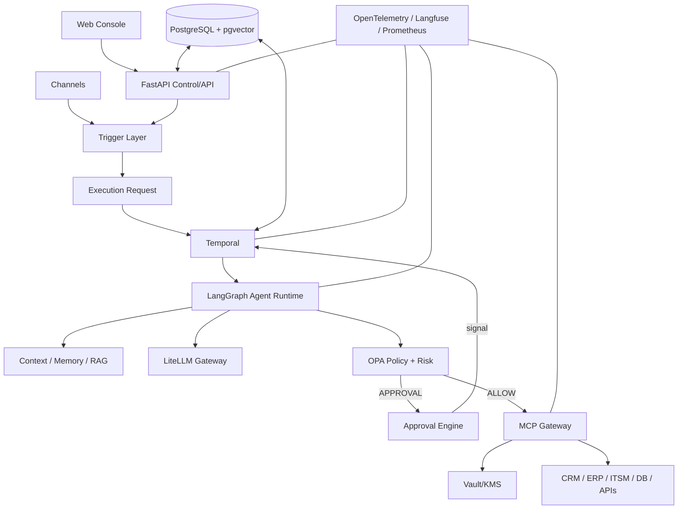

# Digital Employee Platform — Enterprise Architecture

**Version:** 0.1.0  
**Status:** Normative

## 1. Architecture overview

The platform is organized into control-plane capabilities and execution/data-plane capabilities. The separation is logical first; services may be consolidated during MVP deployment.

## 2. Control plane

The control plane manages definitions and governance:

- tenants/deployments;
- Digital Employees and versions;
- roles and skills;
- tasks and triggers;
- policies;
- MCP server definitions;
- tool metadata;
- knowledge sources;
- approvals and governance configuration.

It does not execute arbitrary agent work synchronously in API request threads.

## 3. Execution plane

The execution plane performs actual work:

- Execution Requests;
- Temporal workflows;
- worker activities;
- LangGraph agent runs;
- context construction;
- model calls;
- policy evaluation;
- approvals;
- MCP invocations;
- external system actions;
- observations and outcomes.

## 4. Component responsibilities

| Component | Responsibility | Must not own |
|---|---|---|
| FastAPI | API/control operations | Long-running agent execution |
| PostgreSQL | Domain state and audit metadata | Durable workflow timers |
| Temporal | Durable workflow lifecycle | Agent reasoning |
| LangGraph | Agent reasoning/stateful graph | Authorization |
| LiteLLM | Model abstraction/routing/cost | Business policy |
| Context Manager | Build model context | Authorization |
| OPA | Deterministic policy decision | LLM reasoning |
| Risk Engine | Risk assessment | Final business authorization |
| Approval Engine | Human decisions | Tool execution |
| MCP Gateway | Tool enforcement/integration | Business workflow orchestration |
| Vault/KMS | Secrets | Prompt/context storage |
| Redis | Cache/transient coordination | Source of truth |
| PostgreSQL FTS/pgvector | Retrieval | Authorization by itself |

## 5. Architectural boundary

The most important security boundary is between **untrusted model-generated intent** and **controlled external action**.

The model can propose an action. The Policy Engine and MCP Gateway decide whether the action can be executed.

## 6. Communication

Synchronous APIs are used for short control operations and queries. Durable work is asynchronous.

Typical path:

`POST /executions → Execution Request → Temporal → Worker → LangGraph`

The API should normally return an execution identifier and current status rather than waiting for the agent to finish.

## 7. Scaling

Initial scaling is horizontal at stateless API, MCP Gateway and worker layers. Temporal workers scale by task queue. PostgreSQL is initially the primary persistence dependency.

A service mesh is deliberately not required for MVP.

## 8. Reliability model

Reliability is achieved through:

- durable workflow state;
- retries with classification;
- timeouts;
- heartbeats;
- idempotency;
- circuit breakers;
- rate/concurrency limits;
- DLQ/reconciliation;
- Saga compensation where supported;
- explicit human intervention.

## 9. Data classification

Data entering the platform must carry classification where applicable: PUBLIC, INTERNAL, CONFIDENTIAL, RESTRICTED, PII, FINANCIAL, PCI and SECRET.

Classification influences model routing, logging, memory persistence, external transfer and approval requirements.

## 10. Deployment principle

The initial product should be deployable with Docker Compose or an equivalent simple orchestration environment. Kubernetes becomes an operational option, not an architectural prerequisite.

## 11. Architectural invariants

1. No external action without validation and policy evaluation.
2. No secret in LLM context.
3. No mutable action without an execution identity.
4. Every execution has immutable version references.
5. Tool outputs are untrusted data.
6. Human approvals are durable and auditable.
7. Scheduler creates executions; it does not execute agents directly.
8. Channels are not workflow engines.
