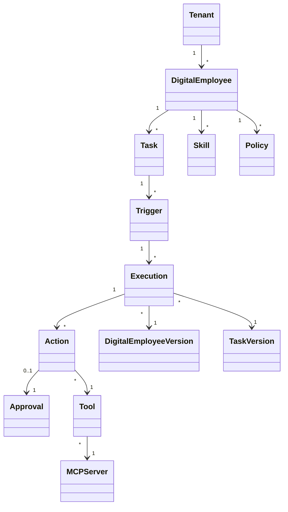

# Digital Employee Platform — Domain Model

**Version:** 0.1.0  
**Status:** Normative

## 1. Core aggregates



## 2. Tenant

A Tenant represents the enterprise boundary in the logical model. In the initial deployment model, one production deployment normally corresponds to one enterprise tenant.

Important attributes:

- `tenant_id`
- `name`
- `status`
- `data_classification_policy`
- `created_at`

## 3. Digital Employee

A Digital Employee is a logical identity. Published versions are immutable.

Core configuration:

- identity;
- role;
- soul/personality guidance;
- skills;
- tool grants;
- policies;
- memory namespace;
- tasks;
- governance configuration.

## 4. Task

A Task defines **what work should be performed**, not the exact low-level execution algorithm.

A task may specify:

- objective;
- input schema;
- expected output;
- schedule;
- trigger configuration;
- concurrency policy;
- timeout;
- retry policy;
- output routing;
- allowed tools;
- policy set;
- approval rules.

## 5. Trigger

A Trigger describes how a task becomes an Execution Request.

Types:

- `CHANNEL`
- `SCHEDULE`
- `EVENT`
- `API`
- `MANUAL`

A trigger contains activation conditions, not agent logic.

### 5.1 Schedule semantics

*Added 2026-10-19 — closes finding K-31/K-32/K-33/K-34/K-35 of `docs/reference/KORTIX-CROSS-MATRIX.md`.*

A recurring trigger must be predictable under failure and under human pause, otherwise a daily business routine silently duplicates or skips work. A `SCHEDULE` trigger therefore declares:

| Aspect | Contract |
|---|---|
| Time basis | An explicit IANA time zone (default `UTC`), plus a rule for what the local slot means when the offset changes (daylight saving): the local wall-clock slot is preserved and the offset is recomputed, never the UTC instant |
| Slot identity | Each occurrence has a **slot identifier**. The execution is keyed on the slot, so a retry of the same occurrence never runs the slot twice |
| Misfire policy | What happens after the scheduler was unable to fire (process restart, pause, outage): either `SKIP` (the missed slot is recorded but not executed) or `CATCH_UP_ONCE` (a single execution catches up the missed slot). The policy is per trigger, not global |
| Overlap policy | What happens when the previous execution of the same trigger is still running: `SKIP`, `QUEUE_ONE` or `PARALLEL` (with `PARALLEL` requiring a concurrency limit) |
| Rate limits | Maximum runs per hour and per day, with a documented behaviour when exceeded (a *skipped* occurrence that is visible, not an error the source escalates) |
| Pause | Triggers can be paused (per trigger and as a project-wide kill switch for automation) while manual invocation remains possible; pause and resume are auditable and record why |
| Delivery guarantees | Scheduling is *at-most-once* per slot by construction of the key; exactly-once delivery of the *trigger* does not imply exactly-once execution of the *effect* — that remains idempotency's job (`04` §12) |

### 5.2 Channel triggers

*Added 2026-10-19 — closes finding K-40 of `docs/reference/KORTIX-CROSS-MATRIX.md`.*

A conversational channel is an untrusted entry point. Before a `CHANNEL` trigger is implemented, the platform must define: identity linking of the human sender, who may address the employee (channel/thread access policy), per-action authorization of what the sender may cause, the ability to stop a running execution from the channel, and auditing of every message that reached the agent. A channel never grants authority: it routes a request into the same governed execution path (`04` §25).

## 6. Execution

Execution is the authoritative business unit of work.

Minimum attributes:

- `execution_id`
- `tenant_id`
- `employee_version_id`
- `task_version_id`
- `trigger_id`
- `status`
- `requested_at`
- `started_at`
- `completed_at`
- `correlation_id`
- `causation_id`
- `idempotency_key`
- `result_summary`
- `failure_code`

## 7. Action

An Action is a proposed or executed side effect inside an execution.

Examples:

- create CRM ticket;
- update invoice status;
- send message;
- create purchase request.

Action state should distinguish proposal, policy decision, approval state, invocation, result and compensation.

## 8. Approval

An Approval is a durable human decision attached to an action or execution.

It should include:

- requested action;
- requester/actor;
- required role;
- approver;
- decision;
- timestamp;
- reason/comment;
- expiration;
- delegation if permitted;
- separation-of-duties constraints.

## 9. Policy

A Policy is a deterministic governance rule. It may produce:

- `ALLOW`
- `DENY`
- `REQUIRE_APPROVAL`

Risk scoring can enrich the decision but does not replace authorization.

Policy decision semantics (suspension on `REQUIRE_APPROVAL`, argument-level granularity, precedence and deny-by-default) are defined in `06` §4.1.

## 10. Tool and MCP Server

A Tool is a typed capability. An MCP Server is the integration boundary exposing one or more tools.

Tool permissions should be explicit and scoped to Digital Employee, task and environment.

## 11. Memory and Knowledge

Memory represents information retained from executions. Knowledge represents external or managed information sources used for retrieval.

Both require namespace, classification and ACL metadata.

## 12. Versioning

Published versions are immutable. An Execution stores the exact:

- employee version;
- task version;
- policy version;
- skill versions;
- model configuration version;
- tool/MCP configuration version.

## 13. State machines

### Execution

```text
CREATED → QUEUED → STARTED → PLANNING → POLICY_CHECK
    → ACTION → OBSERVATION → DECISION
    → COMPLETE

POLICY_CHECK → APPROVAL_REQUIRED → WAITING_APPROVAL → ACTION
ACTION → RETRYING → ACTION
ACTION → FAILED → DLQ / COMPENSATION / RECONCILIATION
```

### Approval

```text
REQUESTED → ASSIGNED → APPROVED
                    ├→ REJECTED
                    ├→ EXPIRED
                    └→ CANCELLED
```

## 14. Invariants

- A Task is not an Execution.
- A Trigger is not a Channel.
- A Digital Employee's Soul cannot override Policy.
- An Approval cannot be inferred from model output.
- A Tool invocation must belong to an Execution.
- Published versions cannot be mutated in place.

## 15. Definition packaging (provisional)

*Added 2026-10-19 — finding K-01 of `docs/reference/KORTIX-CROSS-MATRIX.md`. This is a proposal, not a closed decision: it does not move the authority of definitions out of the control plane.*

Employee, task, skill and policy definitions are the IP of the platform and are authored in the control plane. To make review, portability and environment promotion practical, the platform should be able to:

- **Export** a complete definition set (employee + versions + tasks + triggers + skills + policies + tool grants) as a deterministic, diffable package (files plus a manifest);
- **Import** such a package into another environment (development → staging → production) creating new immutable versions rather than mutating published ones (`§12`);
- **Review** a proposed definition change as a change request with a diff, so that regulated customers can apply their own change control;
- keep the package **derived data**: the control plane remains the source of truth, and an exported package never carries secrets.

A same-shape capability could later allow the platform (not the user) to propose changes to an employee's own definition — always as a reviewed proposal, never as an automatic publication.

Artifacts produced by executions (documents, exports, files) are domain objects as well; their contract lives in `05` §21.
