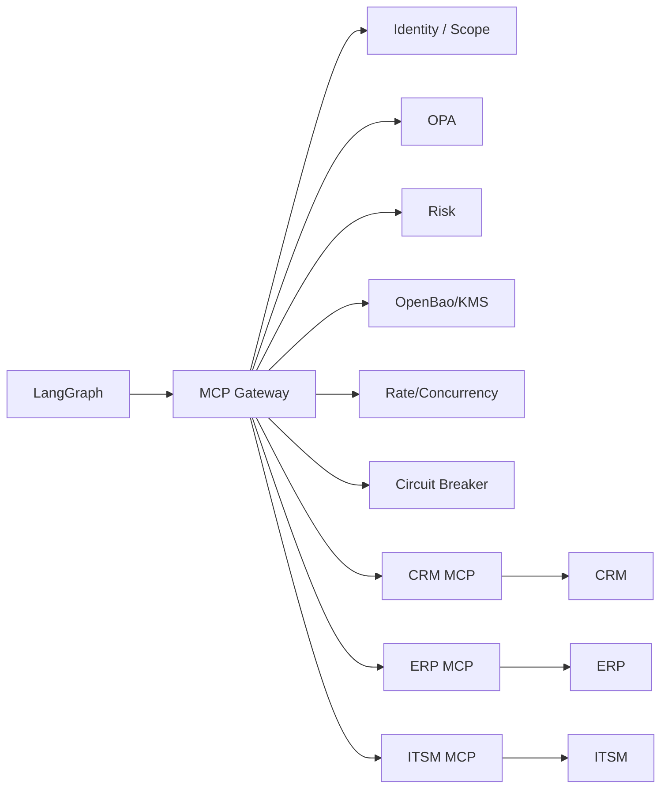

# Digital Employee Platform — MCP Integration Architecture

**Version:** 0.1.0  
**Status:** Normative  
**Created:** 2026-09-21  
**Updated:** 2026-10-19

## 1. Purpose

MCP is the preferred protocol for exposing enterprise capabilities to Digital Employees. It provides a consistent tool interface while the platform retains responsibility for security, governance and execution.

## 2. MCP is not authorization

The existence of an MCP tool does not mean an employee may use it. Authorization occurs in the platform's identity, policy and gateway layers.

## 3. Architecture



## 4. MCP Gateway responsibilities

- authenticate caller;
- authorize capability;
- validate schemas;
- normalize arguments;
- evaluate policy;
- evaluate risk;
- enforce approval;
- resolve credentials;
- apply rate/concurrency limits;
- apply circuit breakers;
- enforce timeouts/retries;
- attach idempotency;
- audit invocation;
- emit telemetry;
- validate results.

## 5. Tool registry

Each tool should have metadata:

```yaml
name: crm.create_case
version: 1
risk: MEDIUM
side_effect: MUTATING
idempotent: true
required_scopes:
  - crm.case.write
classification_impact: CONFIDENTIAL
```

## 6. Tool categories

- Read-only query.
- Analysis/derived computation.
- Draft generation.
- Mutating operation.
- Destructive operation.
- Financial transaction.

Risk and approval requirements should normally increase with side-effect severity.

## 7. Least privilege

A Digital Employee receives only the tools required for its tasks. A task may further restrict tools from the employee's broader grant.

## 8. Credential isolation

The MCP Gateway resolves the credential associated with the integration and scope. The model never receives the raw credential.

Exposure modes (mediated, injected, disabled) and their requirements are defined in `06` §7.1. The gateway is the preferred mediator: for confidential integrations the credential should not be delivered to the executor at all.

## 8.1 Connectors with user identity (on behalf of a person)

*Added 2026-10-19 — closes finding K-29 of `docs/reference/KORTIX-CROSS-MATRIX.md`.*

Two kinds of credentials exist and must not be conflated:

| Kind | Represents | Typical use |
|---|---|---|
| **Service credential** | The integration itself (platform or enterprise service account) | Reading a CRM, opening a ticket, querying monitoring |
| **User-delegated credential** | A specific human, with their own permissions | The employee writes an email "as" its responsible person, reads that person's calendar, acts in a tool whose model is per-user |

For user-delegated connectors the platform must define:

- an explicit **consent** flow per user and per connector, recorded and auditable;
- **scoping**: the employee may act as that user only for tasks that user is authorized to perform; the effective permission set is the intersection of the user's permissions, the employee's grants and policy;
- **token lifecycle**: short-lived tokens with refresh, an owner responsible for revocation, and automatic revocation when the person is offboarded (`06` §2.1);
- **audit**: a delegated action records both identities (the employee and the person it acted as);
- **failure semantics**: an expired or revoked delegation produces a typed, non-retryable error that surfaces as a blocked action — not a silent fallback to a service credential;
- **prohibition**: personal credentials of an individual (their password, their personal API key) are never stored; only delegated, revocable OAuth-style grants.

## 9. Rate limiting

Limits may be defined per:

- tenant;
- employee;
- task;
- tool;
- MCP server;
- external system.

Concurrency limits are particularly important for legacy systems that cannot safely handle high parallelism.

## 10. Circuit breaker

Each integration should have independent circuit state. Repeated failures cause temporary open state and controlled recovery attempts.

## 11. Retry rules

Retries are only automatic for classified transient errors. Business validation errors and authorization failures are not retried blindly.

## 12. Idempotency

Mutating tools should expose idempotency semantics whenever possible. If the underlying system does not support idempotency, the gateway or integration adapter must document its mitigation.

## 13. MCP server trust

MCP servers are external code and must be treated as privileged integration components. Production onboarding should include ownership, source, version, scopes, network destinations, secret requirements and security review.

## 14. Tool output validation

Tool output is untrusted data. Validate against the declared schema and size limits. Do not execute instructions found in tool output.

## 15. Versioning

Tool schemas and MCP server configurations are versioned. An Execution records the versions used.

## 16. Failure modes

The platform distinguishes:

- timeout;
- authentication failure;
- authorization denial;
- rate limit;
- circuit open;
- provider error;
- schema violation;
- business rejection;
- unknown error.

## 17. Observability

Every invocation emits metrics and structured logs with execution/tool identifiers. Sensitive arguments are redacted or represented by hashes/references.

## 18. Future evolution

At higher scale, the gateway may be split into stateless enforcement services or integrated with an API gateway/proxy layer. The logical contract remains unchanged.
