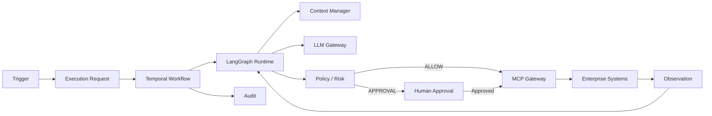

# Digital Employee Platform — Índice de Arquitectura

**Versión:** 0.1.0  
**Estado:** Línea base normativa  
**Fecha:** 2026-09-21

## 1. Propósito

Este directorio es el contrato arquitectónico de la Digital Employee Platform: una plataforma B2B para construir, desplegar, gobernar y operar Empleados Digitales autónomos que ejecutan trabajo de negocio mediante flujos de trabajo duraderos, herramientas controladas y gobernanza humana.

Los documentos están intencionalmente en capas. La intención de producto se separa de la arquitectura empresarial, la semántica de dominio, el comportamiento del runtime, la seguridad, las integraciones, el contexto, las operaciones y las reglas de desarrollo.

## 2. Regla normativa

> **Los documentos de arquitectura son normativos. El código debe implementar la arquitectura; no debe redefinirla silenciosamente.**

Un cambio que afecte los límites de componentes, los límites de seguridad, la persistencia, la semántica de ejecución, los contratos públicos, el modelo de despliegue o la gobernanza debe acompañarse de un ADR o de una revisión explícita de la arquitectura.

## 3. Orden de lectura

1. `01-PRODUCT-VISION.md` — qué es el producto.
2. `02-ENTERPRISE-ARCHITECTURE.md` — cómo se estructura la plataforma.
3. `03-DOMAIN-MODEL.md` — qué significan los objetos de negocio.
4. `04-RUNTIME-EXECUTION-ARCHITECTURE.md` — cómo se ejecuta el trabajo.
5. `05-PERSISTENCE-API-CONTRACTS.md` — estado duradero e interfaces.
6. `06-SECURITY-GOVERNANCE.md` — modelo de seguridad y control.
7. `07-MCP-INTEGRATION-ARCHITECTURE.md` — capacidades empresariales controladas.
8. `08-MEMORY-KNOWLEDGE-CONTEXT.md` — ciclo de vida de la información y el contexto.
9. `09-OBSERVABILITY-EVALUATION.md` — visibilidad operativa y calidad.
10. `10-DEPLOYMENT-OPERATIONS.md` — despliegue y operaciones de producción.
11. ADRs — la justificación inmutable detrás de las decisiones importantes.
12. Guías de desarrollo — reglas para los agentes de implementación y los ingenieros.

## 4. Principios de arquitectura

- **La ejecución es la unidad de trabajo.** Un mensaje, un horario o un evento crea una solicitud de ejecución; no ejecuta directamente código del agente.
- **Los disparadores y los canales son independientes.** Una tarea programada puede enviar un correo; un evento de ERP puede crear un ticket; una solicitud manual puede producir un mensaje de Teams.
- **Temporal es propietario de la durabilidad.** El estado de larga duración, los reintentos, los temporizadores, la cancelación, las señales, la recuperación y las esperas humanas pertenecen a la capa de flujos de trabajo duraderos.
- **LangGraph es propietario de la cognición del agente.** Los bucles de razonamiento, la planificación con estado y el comportamiento del agente orientado a herramientas pertenecen al interior del runtime del agente.
- **Los LLM proponen; los controles deterministas autorizan.** La salida del modelo no es de confianza y nunca constituye autorización.
- **MCP expone capacidades; el MCP Gateway hace cumplir el acceso.** MCP es un protocolo de integración, no el modelo de seguridad.
- **Toda acción externa se verifica contra política y se audita.**
- **Los secretos nunca ingresan a los prompts, al estado del agente, a la memoria ni a los logs ordinarios.**
- **El contenido externo es datos, no instrucciones.** La inyección de prompts se trata como un problema de seguridad de entrada.
- **PostgreSQL es el sistema de registro oficial del estado de negocio/dominio; Temporal es el sistema de registro oficial del estado de los flujos de trabajo.**
- **Las definiciones versionadas son inmutables.** Las ejecuciones conservan las versiones exactas utilizadas.
- **El despliegue de tenant único es el modelo de aislamiento inicial.** La multi-tenencia dinámica no es un supuesto del MVP.

## 5. Runtime canónico

## 6. Reglas de fuente de verdad

| Tema | Autoridad |
|---|---|
| Intención de producto | `01-PRODUCT-VISION.md` |
| Límites de componentes | `02-ENTERPRISE-ARCHITECTURE.md` |
| Semántica de dominio | `03-DOMAIN-MODEL.md` |
| Comportamiento de ejecución | `04-RUNTIME-EXECUTION-ARCHITECTURE.md` |
| Contratos de persistencia/API | `05-PERSISTENCE-API-CONTRACTS.md` |
| Seguridad/gobernanza | `06-SECURITY-GOVERNANCE.md` |
| Comportamiento de MCP | `07-MCP-INTEGRATION-ARCHITECTURE.md` |
| Memoria/contexto | `08-MEMORY-KNOWLEDGE-CONTEXT.md` |
| Observabilidad/evaluación | `09-OBSERVABILITY-EVALUATION.md` |
| Operaciones | `10-DEPLOYMENT-OPERATIONS.md` |
| Justificación arquitectónica | `docs/adr/` |
| Comportamiento de codificación | `docs/development/` |

## 7. Proceso de cambio

1. Identificar el contrato arquitectónico afectado.
2. Determinar si el cambio es un detalle de implementación o arquitectónico.
3. Para cambios arquitectónicos, crear/actualizar un ADR antes de la implementación.
4. Actualizar los documentos afectados y las referencias cruzadas.
5. Agregar o actualizar pruebas/evaluaciones.
6. Implementar.
7. Registrar las implicaciones de migración y de reversión (rollback).

## 8. No objetivos de la línea base

La línea base no exige Kubernetes, Kafka, service mesh, multi-tenencia dinámica, un proveedor de identidad personalizado, una base de datos vectorial personalizada, automatización de navegador sin restricciones, acceso de shell sin restricciones ni un servidor MCP universal.

Estos pueden introducirse más adelante solo cuando los requisitos lo justifiquen.

## 9. Definición de consistencia arquitectónica

Una implementación es arquitectónicamente consistente cuando un revisor puede responder:

> ¿Por qué este Empleado Digital realizó esta acción, usando qué versiones, con qué información, bajo qué política, con qué autorización, contra qué capacidad, y con qué resultado exacto?

Si la plataforma no puede reconstruir esa cadena, la implementación está incompleta desde una perspectiva de gobernanza.

## 10. Documentos de referencia (no normativos)

Estos documentos no definen la arquitectura; la sostienen y son la base de evidencia de los cambios:

| Documento | Propósito |
|---|---|
| `RUNTIME-EXECUTION-FULL-ANNEX-ARCHITECTURE-03.md` | Detalle operativo heredado; **supersedido**, se conserva como referencia de implementación |
| `SPIKE-FASE1-FOUNDATION-investigacion.md` | Plan de validación de la fase Foundation y umbrales GO/NO-GO |
| `KORTIX-analisis-y-licencias.md` | Evaluación independiente de Kortix/Suna como base vs referencia, y su licencia |
| `KORTIX-INVESTIGACION-v0.14.3.md` | Investigación de capacidades de Kortix/Suna a un commit fijo, con evidencia y estado por capacidad |
| `KORTIX-CROSS-MATRIX.md` | Inventario documental, matriz de cruce, brechas, propuestas y descartes explícitos |
| `STACK-LICENCIAS.md` | Inventario de licencias del stack objetivo con clasificación de riesgo comercial |
| `REGISTRO-CAMBIOS-DOCUMENTALES-2026-10-19.md` | Trazabilidad de los cambios documentales del 2026-10-19 |
| `DECISIONES-PENDIENTES.md` | Decisiones que no pueden cerrarse solo con análisis documental |

Regla de cita: el anexo y el spike conservan **numeraciones de sección heredadas** (§64, §66, §89…) que no existen en los documentos normativos. Citar siempre el documento y la sección normativos; los números heredados son punteros históricos.

## 11. Revisión documental 2026-10-19

Revisión aditiva. Se **extendieron** secciones; ningún principio arquitectónico, frontera, nombre de contrato ni ADR cambió. Cambios: `03` §5.1–5.2, §15 · `04` §2, §4, §11, §21–25 · `05` §1, §5.1–5.2, §10.1, §11, §20–22 · `06` §2.1–2.2, §4.1, §7.1, §17–18 · `07` §8.1 · `08` §13 · `09` §3, §6, §12.1, §13 · `10` §17–18. Motivo y evidencia: `docs/reference/REGISTRO-CAMBIOS-DOCUMENTALES-2026-10-19.md`.