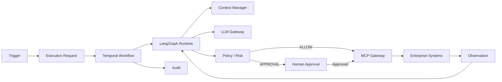

# Digital Employee Platform — Índice de Arquitectura

**Versión:** 0.1.0  
**Estado:** Línea base normativa  
**Fecha:** 2026-09-21  
**Creado:** 2026-09-21  
**Actualizado:** 2026-10-20

## 1. Propósito

Este directorio es el contrato arquitectónico de la Digital Employee Platform: una plataforma B2B para construir, desplegar, gobernar y operar Empleados Digitales autónomos que ejecutan trabajo de negocio mediante flujos de trabajo duraderos, herramientas controladas y gobernanza humana.

Los documentos están intencionalmente en capas. La intención de producto se separa de la arquitectura empresarial, la semántica de dominio, el comportamiento del runtime, la seguridad, las integraciones, el contexto, las operaciones y las reglas de desarrollo.

## 2. Regla normativa

> **Los documentos de arquitectura son normativos. El código debe implementar la arquitectura; no debe redefinirla silenciosamente.**

Un cambio que afecte los límites de componentes, los límites de seguridad, la persistencia, la semántica de ejecución, los contratos públicos, el modelo de despliegue o la gobernanza debe acompañarse de un ADR o de una revisión explícita de la arquitectura.

## 3. Orden de lectura

1. `01-PRODUCT-VISION.md` — qué es el producto.
2. `02-ENTERPRISE-ARCHITECTURE.md` — cómo se estructura la plataforma.
3. `03-DOMAIN-MODEL.md` — qué significan los objetos de negocio.
4. `04-RUNTIME-EXECUTION-ARCHITECTURE.md` — cómo se ejecuta el trabajo.
5. `05-PERSISTENCE-API-CONTRACTS.md` — estado duradero e interfaces.
6. `06-SECURITY-GOVERNANCE.md` — modelo de seguridad y control.
7. `07-MCP-INTEGRATION-ARCHITECTURE.md` — capacidades empresariales controladas.
8. `08-MEMORY-KNOWLEDGE-CONTEXT.md` — ciclo de vida de la información y el contexto.
9. `09-OBSERVABILITY-EVALUATION.md` — visibilidad operativa y calidad.
10. `10-DEPLOYMENT-OPERATIONS.md` — despliegue y operaciones de producción.
11. ADRs — la justificación inmutable detrás de las decisiones importantes.
12. Guías de desarrollo — reglas para los agentes de implementación y los ingenieros.

## 4. Principios de arquitectura

- **La ejecución es la unidad de trabajo.** Un mensaje, un horario o un evento crea una solicitud de ejecución; no ejecuta directamente código del agente.
- **Los disparadores y los canales son independientes.** Una tarea programada puede enviar un correo; un evento de ERP puede crear un ticket; una solicitud manual puede producir un mensaje de Teams.
- **Temporal es propietario de la durabilidad.** El estado de larga duración, los reintentos, los temporizadores, la cancelación, las señales, la recuperación y las esperas humanas pertenecen a la capa de flujos de trabajo duraderos.
- **LangGraph es propietario de la cognición del agente.** Los bucles de razonamiento, la planificación con estado y el comportamiento del agente orientado a herramientas pertenecen al interior del runtime del agente.
- **Los LLM proponen; los controles deterministas autorizan.** La salida del modelo no es de confianza y nunca constituye autorización.
- **MCP expone capacidades; el MCP Gateway hace cumplir el acceso.** MCP es un protocolo de integración, no el modelo de seguridad.
- **Toda acción externa se verifica contra política y se audita.**
- **Los secretos nunca ingresan a los prompts, al estado del agente, a la memoria ni a los logs ordinarios.**
- **El contenido externo es datos, no instrucciones.** La inyección de prompts se trata como un problema de seguridad de entrada.
- **PostgreSQL es el sistema de registro oficial del estado de negocio/dominio; Temporal es el sistema de registro oficial del estado de los flujos de trabajo.**
- **Las definiciones versionadas son inmutables.** Las ejecuciones conservan las versiones exactas utilizadas.
- **El despliegue de tenant único es el modelo de aislamiento inicial.** La multi-tenencia dinámica no es un supuesto del MVP.

## 5. Runtime canónico

## 6. Reglas de fuente de verdad

| Tema | Autoridad |
|---|---|
| Intención de producto | `01-PRODUCT-VISION.md` |
| Límites de componentes | `02-ENTERPRISE-ARCHITECTURE.md` |
| Semántica de dominio | `03-DOMAIN-MODEL.md` |
| Comportamiento de ejecución | `04-RUNTIME-EXECUTION-ARCHITECTURE.md` |
| Contratos de persistencia/API | `05-PERSISTENCE-API-CONTRACTS.md` |
| Seguridad/gobernanza | `06-SECURITY-GOVERNANCE.md` |
| Comportamiento de MCP | `07-MCP-INTEGRATION-ARCHITECTURE.md` |
| Memoria/contexto | `08-MEMORY-KNOWLEDGE-CONTEXT.md` |
| Observabilidad/evaluación | `09-OBSERVABILITY-EVALUATION.md` |
| Operaciones | `10-DEPLOYMENT-OPERATIONS.md` |
| Justificación arquitectónica | `docs/adr/` |
| Comportamiento de codificación | `docs/development/` |

## 7. Proceso de cambio

1. Identificar el contrato arquitectónico afectado.
2. Determinar si el cambio es un detalle de implementación o arquitectónico.
3. Para cambios arquitectónicos, crear/actualizar un ADR antes de la implementación.
4. Actualizar los documentos afectados y las referencias cruzadas.
5. Agregar o actualizar pruebas/evaluaciones.
6. Implementar.
7. Registrar las implicaciones de migración y de reversión (rollback).

## 8. No objetivos de la línea base

La línea base no exige Kubernetes, Kafka, service mesh, multi-tenencia dinámica, un proveedor de identidad personalizado, una base de datos vectorial personalizada, automatización de navegador sin restricciones, acceso de shell sin restricciones ni un servidor MCP universal.

Estos pueden introducirse más adelante solo cuando los requisitos lo justifiquen.

## 9. Definición de consistencia arquitectónica

Una implementación es arquitectónicamente consistente cuando un revisor puede responder:

> ¿Por qué este Empleado Digital realizó esta acción, usando qué versiones, con qué información, bajo qué política, con qué autorización, contra qué capacidad, y con qué resultado exacto?

Si la plataforma no puede reconstruir esa cadena, la implementación está incompleta desde una perspectiva de gobernanza.

## 10. Documentos de referencia (no normativos)

Estos documentos no definen la arquitectura; la sostienen y son la base de evidencia de los cambios:

| Documento | Propósito |
|---|---|
| `RUNTIME-EXECUTION-FULL-ANNEX-ARCHITECTURE-03.md` | Detalle operativo heredado; **supersedido**, se conserva como referencia de implementación |
| `SPIKE-FASE1-FOUNDATION-investigacion.md` | Plan de validación de la fase Foundation y umbrales GO/NO-GO |
| `KORTIX-analisis-y-licencias.md` | Evaluación independiente de Kortix/Suna como base vs referencia, y su licencia |
| `KORTIX-INVESTIGACION-v0.14.3.md` | Investigación de capacidades de Kortix/Suna a un commit fijo, con evidencia y estado por capacidad |
| `KORTIX-CROSS-MATRIX.md` | Inventario documental, matriz de cruce, brechas, propuestas y descartes explícitos |
| `STACK-LICENCIAS.md` | Inventario de licencias del stack objetivo con clasificación de riesgo comercial |
| `REGISTRO-CAMBIOS-DOCUMENTALES-2026-10-19.md` | Trazabilidad de los cambios documentales del 2026-10-19 |
| `REGISTRO-CAMBIOS-2026-10-19-AUDITORIA.md` | Trazabilidad de la auditoría de consistencia del 2026-10-19 (archivo, sección, motivo, estado anterior/nuevo, validación) |
| `AUDITORIA-CONSISTENCIA-2026-10-19.md` | Informe de auditoría de consistencia: alcance, hallazgos por gravedad, evidencia exacta, cambios realizados y riesgos abiertos |
| `INVARIANTES-Y-PRUEBAS.md` | Invariantes arquitectónicos con su fuente normativa, el riesgo que evitan, la prueba exigida, su estado actual y la fase en que debe ejecutarse |
| `REGISTRO-CAMBIOS-2026-10-19-ADR-011-ACEPTADO.md` | Registro de cambios de la aceptación de `ADR-011` y de los renombres normativos de componentes que habilitó |
| `VERIFICACION-POST-AUDITORIA-2026-10-19.md` | Informe de verificación posterior (estado de los archivos publicados, cuestión del código reutilizable, riesgos abiertos) |
| `REGISTRO-CAMBIOS-2026-10-19-VERIFICACION-POST-AUDITORIA.md` | Registro de cambios de la verificación posterior (V-1…V-8) |
| `REGISTRO-CAMBIOS-2026-10-19-DECISIONES-RESPONSABLE.md` | Registro de cambios de las decisiones del responsable del producto del 2026-10-19 (`ADR-012`–`ADR-014`, DP-1/DP-2/DP-5/DP-6/DP-18/DP-19/DP-20, validadores publicados y conectados a CI) |
| `COMPATIBILIDAD-Y-LICENCIAS-PREPARACION.md` | Preparación de las pruebas de compatibilidad y de la revisión de licencias del artefacto distribuible: versiones de referencia verificadas, usos a probar, entregables y riesgos |
| `DECISIONES-PENDIENTES.md` | Decisiones que no pueden cerrarse solo con análisis documental |

### Documentos de producto MVP propuestos (2026-10-20)

La propuesta de producto vive en `docs/product/` y sus espejos en `docs/es/product/`: `MVP-PRD.md`, `MVP-DELIVERY-PLAN.md` y `MVP-TRACEABILITY-MATRIX.md`. Limita el primer demostrador a un Empleado Digital de Cobranzas, consola web propia mínima, datos sintéticos, integración simulada, aprobación humana durable y pruebas medibles. **El alcance aún no está aceptado**: Cobranzas y el primer canal siguen siendo recomendaciones; DP-3 continúa abierta. La propuesta no modifica arquitectura ni ADR y no cierra gates técnicos, de licencia o legales. Registro: `docs/reference/REGISTRO-MVP-DEFINITION-2026-10-20.md`.

Regla de cita: el anexo y el spike conservan **numeraciones de sección heredadas** (§64, §66, §89…) que no existen en los documentos normativos. Citar siempre el documento y la sección normativos; los números heredados son punteros históricos.

## 11. Revisión documental 2026-10-19

Revisión aditiva. Se **extendieron** secciones; ningún principio arquitectónico, frontera, nombre de contrato ni ADR cambió. Cambios: `03` §5.1–5.2, §15 · `04` §2, §4, §11, §21–25 · `05` §1, §5.1–5.2, §10.1, §11, §20–22 · `06` §2.1–2.2, §4.1, §7.1, §17–18 · `07` §8.1 · `08` §13 · `09` §3, §6, §12.1, §13 · `10` §17–18. Motivo y evidencia: `docs/reference/REGISTRO-CAMBIOS-DOCUMENTALES-2026-10-19.md`.

## 12. Auditoría de consistencia 2026-10-19

Segunda revisión del mismo día: una **auditoría** del paquete, no una extensión. No cambió ninguna decisión arquitectónica ni se agregó ninguna dependencia.

- **Corregido:** contadores e inventarios del paquete (`00-INDEX.md` decía 26 archivos y citaba una ruta equivocada del manifiesto; la matriz de cruce decía 62 archivos; el espejo español del manifiesto estaba desactualizado) y trazabilidad de metadatos (`Creado`/`Actualizado` en los 11 documentos de arquitectura y las 5 guías; `Fecha` en los 11 ADR; *frontmatter* en los documentos de referencia).
- **Aclarado:** la frontera de durabilidad en `04` §21.2 (las cinco nociones — corrida cognitiva, espera humana duradera, recuperación del workflow, activity fallida, resultados de negocio — ahora son una tabla explícita); lectura frente a comando en `04` §22; *patching* de Temporal y cutover de workers en `04` §24; las modalidades comerciales separadas del límite arquitectónico en `01` §7.1.
- **Anotado, no sustituido (al momento de la auditoría):** los componentes nombrados en `02` §4, `05` §1, `09` §2 y `00-INDEX.md` llevaban una nota explícita ("componente saliente / sustituto de referencia, pendiente de aceptación formal de `ADR-011`"). No se renombró ningún componente en silencio ni se introdujo ninguna dependencia. **Superado horas después por la aceptación (ver §13).**
- **Separado:** `ADR-011` declara ahora sus cinco capas de formalización (decisión de producto, aceptación formal, compatibilidad técnica, verificación de licencias, validación legal) en lugar de dar a entender que una cierra la siguiente.
- Hallazgos, evidencia y riesgos abiertos: `docs/reference/AUDITORIA-CONSISTENCIA-2026-10-19.md`. Trazabilidad cambio por cambio: `docs/reference/REGISTRO-CAMBIOS-2026-10-19-AUDITORIA.md`. Pruebas que se deben: `docs/reference/INVARIANTES-Y-PRUEBAS.md`.

## 13. Aceptación de `ADR-011` 2026-10-19

Tercera revisión del mismo día: el responsable de producto **aceptó `ADR-011`** (`Propuesto` → `Aceptado`). La política de licencias libres pasó a ser regla normativa del paquete y la sustitución dejó de ser una anotación:

- **Renombrado (normativo):** `OpenBao` reemplaza a `Vault`/`Vault-KMS` en `02` §4 (tabla y diagrama), `04` (diagrama de credenciales), `06` §7, `07` (diagrama MCP), `10` §1–§3 y la nota de implementación de `ADR-007`; `Valkey` reemplaza a `Redis` en `00-INDEX.md`, `02` §4, `05` §1 y `10` §1; `Perses` reemplaza a `Grafana` y `VictoriaLogs`/`OpenSearch` a `Loki` en `09` §2; `SeaweedFS` sigue siendo la referencia para almacenamiento de objetos. Espejos en español y `EXPLICACION-NO-TECNICA.md` actualizados en la misma revisión.
- **Sin cambios por este acto:** ninguna decisión arquitectónica, frontera, nombre de contrato ni dependencia. **No se cerró ninguna prueba:** verificar una licencia no es validar técnicamente una sustitución (DP-5 y DP-6 siguen abiertas).
- Trazabilidad: `docs/reference/REGISTRO-CAMBIOS-2026-10-19-ADR-011-ACEPTADO.md`. Política y evidencia de licencias: `docs/reference/STACK-LICENCIAS.md`.

## 14. Verificación posterior 2026-10-19

Revisión de seguimiento del estado **publicado** (commit `8c881ea`), para comprobar si las correcciones declaradas por la auditoría y la aceptación seguían vigentes en los propios archivos — sin tomar un informe previo como evidencia.

- **Corregido:** los dos manifiestos describían `ADR-011` con su estado anterior a la aceptación (ahora `Accepted` / `Aceptado`); `DP-17` se contradecía con su propio estado (la descripción seguía diciendo que la política no era regla vigente); `DP-6` presentaba Vault, Grafana, Loki y MinIO como componentes **del stack objetivo actual** (ahora "stack evaluado… fuera del stack de referencia"); el §Contexto de `ADR-011` no aclaraba que describe la situación a la fecha de la decisión; y `00-INDEX.md` ahora separa el recuento **histórico** (línea base inicial de 26) del **vigente** (**27**).
- **Ambigüedad sobre código reutilizable resuelta con evidencia, no por inferencia:** dos documentos afirmaban la existencia de código reutilizable (un control plane / tenancy / SSO "de Hermes-OS" y "un proyecto base que reutilizamos"). El paquete **no declara repositorio, alcance ni interfaces de ese sistema**, así que la afirmación no tenía respaldo verificable. Los textos ahora dicen que la plataforma **se construye desde cero** sobre este paquete documental, que **Hermes-OS es un sistema aparte** cuyo código **no** forma parte de este proyecto, y la cuestión reutilizar-vs-integrar queda registrada como **DP-19**, pendiente de decisión del responsable.
- **No reproducible:** la presunta persistencia de "26 documentos", de la ruta `docs/DOCUMENT-MANIFEST.md` y de `Redis`/`Vault` en el stack de `00-INDEX.md`. En los archivos publicados ya estaban corregidas (`51f7f686` para recuento y ruta, `8c881ea` para el stack); lo que faltaba era separar el recuento histórico del vigente, y eso se agregó.
- **Sin cambios:** ninguna decisión arquitectónica, frontera, contrato ni dependencia. DP-5 y DP-6 siguen abiertas (ninguna sustitución está validada técnicamente) y los documentos históricos, de investigación y comparativos conservan los nombres anteriores de los componentes.
- Informe: `docs/reference/VERIFICACION-POST-AUDITORIA-2026-10-19.md`. Trazabilidad: `docs/reference/REGISTRO-CAMBIOS-2026-10-19-VERIFICACION-POST-AUDITORIA.md`.

## 15. Decisiones del responsable del producto 2026-10-19

El responsable del producto resolvió ocho puntos abiertos. Tres cambiaban una frontera o un contrato normativo, así que pasaron por un **ADR** en lugar de una edición silenciosa:

| Decisión | Dónde vive ahora |
|---|---|
| **DP-1** — persistencia por paso de LangGraph en **PostgreSQL, esquema de runtime separado**, retención 7 días tras el estado terminal; Temporal sigue siendo la única autoridad de durabilidad | `ADR-012`, `04` §21.2, `05` §1 (pruebas pendientes) |
| **DP-2** — **sin ejecución arbitraria de código** del agente en el MVP; **servicio restringido de generación de artefactos** | `ADR-013`, `04` §25 (punto 1) (pruebas pendientes) |
| **Semántica de aprobaciones** — el envejecimiento **no** produce cancelación ni rechazo automáticos (24 h / 72 h / 7 días); reemplaza el "rechazo por defecto" de `05` §10.1 | `ADR-014`, `05` §10.1 |
| **Search Attributes** — conjunto operativo mínimo `TenantId`, `EmployeeId`, `ApprovalStatus`, `ApprovalType`, `ApprovalPriority`, `AssignedGroup`, `ApprovalDueAt` (+ `ApproverSubjectId` opcional); índice, nunca fuente de verdad | `04` §22.1 (DP-20, prueba de contrato pendiente) |
| **DP-18** — valores de línea base de ingeniería del MVP: presupuestos, delegación, alertas, retención, RPO/RTO, aceptación de calidad y seguridad | `04` §16/§23, `09` §12.1/§13, `10` §9, `01` §8, DP-18 |
| **DP-19** — Hermes-OS es **referencia de diseño, no un sistema a integrar** (cerrada, opción a) | `00-INDEX.md`, `EXPLICACION-NO-TECNICA.md`, DP-19 |
| **Modalidad SaaS** — instalaciones dedicadas por cliente en la primera etapa productiva; SaaS con recursos compartidos solo tras validar el aislamiento y cerrar un ADR específico | `01` §7.1, DP-7 |
| **P-27** — validadores documentales **publicados y conectados a CI**; se verificó una corrida en verde y una **falla real** ante un enlace roto introducido a propósito (PR cerrado sin fusionar) | `tools/docs-verify/`, `.github/workflows/docs-verify.yml` |

**Disciplina de capas:** son **decisiones adoptadas** y **diseño documentado**. Ninguna sustitución está técnicamente validada, no se ejecutó ninguna prueba y la revisión de licencias del artefacto distribuible no fue emitida: **la distribución comercial sigue bloqueada** (DP-5, DP-6). Trazabilidad: `docs/reference/REGISTRO-CAMBIOS-2026-10-19-DECISIONES-RESPONSABLE.md`; preparación: `docs/reference/COMPATIBILIDAD-Y-LICENCIAS-PREPARACION.md`.
