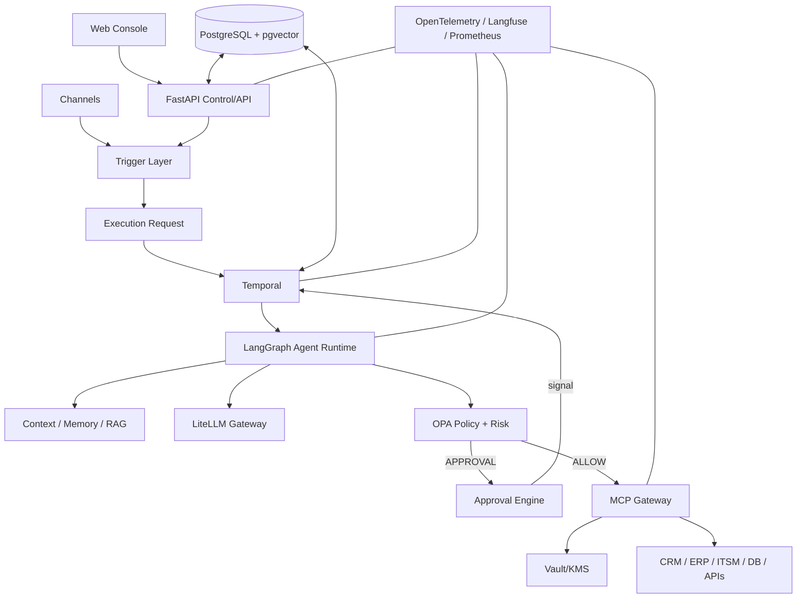

# Digital Employee Platform — Arquitectura Empresarial

**Versión:** 0.1.0  
**Estado:** Normativo

## 1. Resumen de arquitectura

La plataforma se organiza en capacidades del plano de control y capacidades del plano de ejecución/plano de datos. La separación es lógica en primer lugar; los servicios pueden consolidarse durante el despliegue del MVP.

## 2. Plano de control

El plano de control gestiona las definiciones y la gobernanza:

- tenants/despliegues;
- Empleados Digitales y versiones;
- roles y habilidades;
- tareas y disparadores;
- políticas;
- definiciones de servidores MCP;
- metadatos de herramientas;
- fuentes de conocimiento;
- aprobaciones y configuración de gobernanza.

No ejecuta trabajo de agente arbitrario de forma síncrona en los hilos de las solicitudes de API.

## 3. Plano de ejecución

El plano de ejecución realiza el trabajo real:

- Solicitudes de ejecución;
- flujos de trabajo de Temporal;
- actividades de workers;
- ejecuciones de agentes de LangGraph;
- construcción de contexto;
- llamadas a modelos;
- evaluación de políticas;
- aprobaciones;
- invocaciones de MCP;
- acciones sobre sistemas externos;
- observaciones y resultados.

## 4. Responsabilidades de los componentes

| Componente | Responsabilidad | No debe ser propietario |
|---|---|---|
| FastAPI | Operaciones de API/control | Ejecución de agentes de larga duración |
| PostgreSQL | Estado de dominio y metadatos de auditoría | Temporizadores de flujos de trabajo duraderos |
| Temporal | Ciclo de vida de flujos de trabajo duraderos | Razonamiento del agente |
| LangGraph | Razonamiento del agente/grafo con estado | Autorización |
| LiteLLM | Abstracción/routing de modelos/costo | Política de negocio |
| Administrador de contexto | Construir el contexto del modelo | Autorización |
| OPA | Decisión de política determinista | Razonamiento del LLM |
| Motor de riesgo | Evaluación de riesgo | Autorización final de negocio |
| Motor de aprobación | Decisiones humanas | Ejecución de herramientas |
| MCP Gateway | Cumplimiento/integración de herramientas | Orquestación de flujos de trabajo de negocio |
| Vault/KMS | Secretos | Almacenamiento de prompts/contexto |
| Redis | Caché/coordinación transitoria | Fuente de verdad |
| PostgreSQL FTS/pgvector | Recuperación | Autorización por sí solo |

## 5. Límite arquitectónico

El límite de seguridad más importante está entre **la intención no confiable generada por el modelo** y **la acción externa controlada**.

El modelo puede proponer una acción. El motor de políticas y el MCP Gateway deciden si la acción puede ejecutarse.

## 6. Comunicación

Las APIs síncronas se usan para operaciones de control cortas y consultas. El trabajo duradero es asíncrono.

Ruta típica:

`POST /executions → Solicitud de ejecución → Temporal → Worker → LangGraph`

La API normalmente debería devolver un identificador de ejecución y el estado actual en lugar de esperar a que el agente termine.

## 7. Escalado

El escalado inicial es horizontal en las capas de API sin estado, MCP Gateway y workers. Los workers de Temporal escalan por cola de tareas. PostgreSQL es inicialmente la dependencia de persistencia principal.

Un service mesh deliberadamente no es un requisito para el MVP.

## 8. Modelo de confiabilidad

La confiabilidad se logra mediante:

- estado de flujos de trabajo duraderos;
- reintentos con clasificación;
- timeouts;
- heartbeats (latidos);
- idempotencia;
- cortacircuitos (circuit breakers);
- límites de peticiones/concurrencia;
- DLQ/conciliación;
- compensación Saga donde esté soportada;
- intervención humana explícita.

## 9. Clasificación de datos

Los datos que ingresan a la plataforma deben portar clasificación cuando corresponda: PUBLIC, INTERNAL, CONFIDENTIAL, RESTRICTED, PII, FINANCIAL, PCI y SECRET.

La clasificación influye en el routing de modelos, el logging, la persistencia en memoria, la transferencia externa y los requisitos de aprobación.

## 10. Principio de despliegue

El producto inicial debería ser desplegable con Docker Compose o un entorno de orquestación simple equivalente. Kubernetes se convierte en una opción operativa, no en un requisito arquitectónico.

## 11. Invariantes arquitectónicos

1. Ninguna acción externa sin validación y evaluación de políticas.
2. Ningún secreto en el contexto del LLM.
3. Ninguna acción mutable sin una identidad de ejecución.
4. Toda ejecución tiene referencias de versión inmutables.
5. Las salidas de herramientas son datos no confiables.
6. Las aprobaciones humanas son duraderas y auditables.
7. El scheduler crea ejecuciones; no ejecuta agentes directamente.
8. Los canales no son motores de flujos de trabajo.