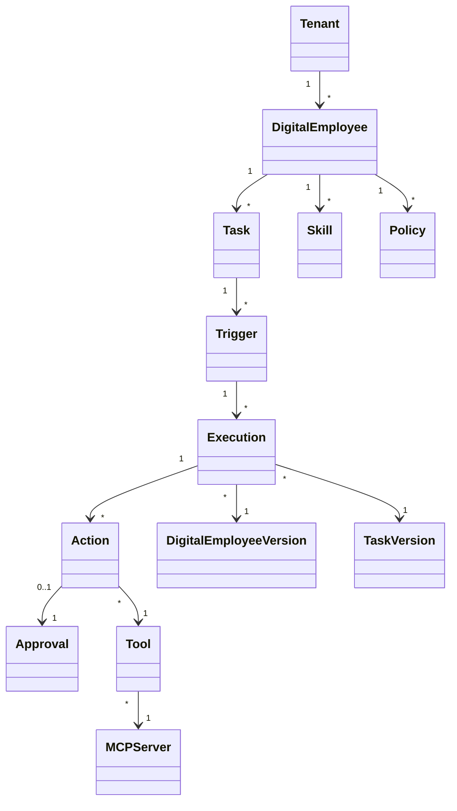

# Plataforma de Empleado Digital — Modelo de Dominio

**Versión:** 0.1.0  
**Estado:** Normativo

## 1. Agregados principales



## 2. Tenant

Un Tenant representa el límite de la empresa en el modelo lógico. En el modelo de despliegue inicial, un despliegue de producción normalmente corresponde a un tenant de una sola empresa.

Atributos importantes:

- `tenant_id`
- `name`
- `status`
- `data_classification_policy`
- `created_at`

## 3. Empleado Digital

Un Empleado Digital es una identidad lógica. Las versiones publicadas son inmutables.

Configuración principal:

- identidad;
- rol;
- guía de personalidad (soul);
- habilidades;
- concesiones de herramientas;
- políticas;
- espacio de nombres de memoria;
- tareas;
- configuración de gobernanza.

## 4. Tarea

Una Tarea define **qué trabajo debe realizarse**, no el algoritmo exacto de ejecución de bajo nivel.

Una tarea puede especificar:

- objetivo;
- esquema de entrada;
- salida esperada;
- programación (schedule);
- configuración de disparadores;
- política de concurrencia;
- tiempo de espera (timeout);
- política de reintentos;
- ruteo de salida;
- herramientas permitidas;
- conjunto de políticas;
- reglas de aprobación.

## 5. Disparador

Un Disparador describe cómo una tarea se convierte en una Solicitud de Ejecución.

Tipos:

- `CHANNEL`
- `SCHEDULE`
- `EVENT`
- `API`
- `MANUAL`

Un disparador contiene condiciones de activación, no lógica de agente.

### 5.1 Semántica de calendarización

*Agregado 2026-10-19 — cierra el hallazgo K-31/K-32/K-33/K-34/K-35 de `docs/reference/KORTIX-CROSS-MATRIX.md`.*

Un disparador recurrente debe ser predecible ante fallas y ante pausas humanas; si no, una rutina diaria de negocio duplica o pierde trabajo en silencio. Un disparador `SCHEDULE` declara:

| Aspecto | Contrato |
|---|---|
| Base horaria | Zona horaria IANA explícita (por defecto `UTC`) y regla para el cambio de offset: se preserva la **hora local de pared** y se recalcula el offset, nunca el instante UTC |
| Identidad del slot | Cada ocurrencia tiene un **identificador de slot**; la ejecución se keyea sobre el slot, de modo que un reintento nunca corre el slot dos veces |
| Política de misfire | Qué pasa cuando el planificador no pudo disparar (reinicio, pausa, caída): `SKIP` (se registra pero no se ejecuta) o `CATCH_UP_ONCE` (una única ejecución recupera el slot perdido). Se define por disparador, no global |
| Política de solapamiento | Qué pasa si la ejecución anterior del mismo disparador sigue corriendo: `SKIP`, `QUEUE_ONE` o `PARALLEL` (con límite de concurrencia) |
| Límites de corrida | Máximo de corridas por hora y por día, con comportamiento documentado al excederlo (ocurrencia *salteada* visible, no un error que el emisor escale) |
| Pausa | Se pueden pausar disparadores (uno y como interruptor general de automatización) dejando disponible la invocación manual; pausa y reanudación son auditables y registran el motivo |
| Garantías | La calendarización es *a lo sumo una vez* por slot por construcción de la clave; entrega exactamente-una-vez del **disparador** no implica ejecución exactamente-una-vez del **efecto** — eso es responsabilidad de la idempotencia (`04` §12) |

### 5.2 Disparadores por canal

*Agregado 2026-10-19 — cierra el hallazgo K-40 de `docs/reference/KORTIX-CROSS-MATRIX.md`.*

Un canal conversacional es una puerta de entrada no confiable. Antes de implementar un disparador `CHANNEL` hay que definir: vinculación de identidad del remitente humano, quién puede dirigirse al empleado (política de acceso al canal/hilo), autorización por acción de lo que el remitente puede provocar, capacidad de detener una ejecución en curso desde el canal, y auditoría de cada mensaje que llegó al agente. Un canal nunca otorga autoridad: enruta un pedido al mismo camino de ejecución gobernada (`04` §25).

## 6. Ejecución

La Ejecución es la unidad de negocio de trabajo autoritativa.

Atributos mínimos:

- `execution_id`
- `tenant_id`
- `employee_version_id`
- `task_version_id`
- `trigger_id`
- `status`
- `requested_at`
- `started_at`
- `completed_at`
- `correlation_id`
- `causation_id`
- `idempotency_key`
- `result_summary`
- `failure_code`

## 7. Acción

Una Acción es un efecto secundario propuesto o ejecutado dentro de una ejecución.

Ejemplos:

- crear ticket en CRM;
- actualizar estado de factura;
- enviar mensaje;
- crear solicitud de compra.

El estado de la acción debe distinguir entre propuesta, decisión de política, estado de aprobación, invocación, resultado y compensación.

## 8. Aprobación

Una Aprobación es una decisión humana duradera adjunta a una acción o ejecución.

Debe incluir:

- acción solicitada;
- solicitante/actor;
- rol requerido;
- aprobador;
- decisión;
- marca de tiempo;
- motivo/comentario;
- vencimiento;
- delegación si está permitida;
- restricciones de separación de funciones.

## 9. Política

Una Política es una regla de gobernanza determinista. Puede producir:

- `ALLOW`
- `DENY`
- `REQUIRE_APPROVAL`

La puntuación de riesgo puede enriquecer la decisión, pero no reemplaza la autorización.

## 10. Herramienta y Servidor MCP

Una Herramienta es una capacidad tipada. Un Servidor MCP es el límite de integración que expone una o más herramientas.

Los permisos de las herramientas deben ser explícitos y limitados al Empleado Digital, la tarea y el entorno.

## 11. Memoria y conocimiento

La Memoria representa la información retenida de las ejecuciones. El Conocimiento representa fuentes de información externas o gestionadas utilizadas para la recuperación.

Ambos requieren metadatos de espacio de nombres, clasificación y ACL.

## 12. Control de versiones

Las versiones publicadas son inmutables. Una Ejecución almacena las versiones exactas de:

- versión del empleado;
- versión de la tarea;
- versión de la política;
- versiones de las habilidades;
- versión de la configuración del modelo;
- versión de la configuración de herramientas/MCP.

## 13. Máquinas de estados

### Ejecución

```text
CREATED → QUEUED → STARTED → PLANNING → POLICY_CHECK
    → ACTION → OBSERVATION → DECISION
    → COMPLETE

POLICY_CHECK → APPROVAL_REQUIRED → WAITING_APPROVAL → ACTION
ACTION → RETRYING → ACTION
ACTION → FAILED → DLQ / COMPENSATION / RECONCILIATION
```

### Aprobación

```text
REQUESTED → ASSIGNED → APPROVED
                    ├→ REJECTED
                    ├→ EXPIRED
                    └→ CANCELLED
```

## 14. Invariantes

- Una Tarea no es una Ejecución.
- Un Disparador no es un Canal.
- La personalidad de un Empleado Digital no puede reemplazar la Política.
- Una Aprobación no puede inferirse de la salida del modelo.
- Una invocación de herramienta debe pertenecer a una Ejecución.
- Las versiones publicadas no pueden modificarse en su lugar.

## 15. Empaquetado de definiciones (provisional)

*Agregado 2026-10-19 — hallazgo K-01 de `docs/reference/KORTIX-CROSS-MATRIX.md`. Es una **propuesta**, no una decisión cerrada: no mueve la autoridad de las definiciones fuera del control plane.*

Las definiciones de empleados, tareas, skills y políticas son la propiedad intelectual de la plataforma y se autoran en el control plane. Para hacer práctica la revisión, la portabilidad y la promoción de entornos, la plataforma debería poder:

- **Exportar** un conjunto completo de definiciones (empleado + versiones + tareas + disparadores + skills + políticas + permisos de herramientas) como un paquete determinista y diffeable (archivos + manifiesto);
- **Importar** ese paquete en otro entorno (desarrollo → staging → producción) creando **nuevas versiones inmutables** en lugar de mutar las publicadas (`§12`);
- **Revisar** un cambio de definición como change request con diff, para que clientes regulados apliquen su propio control de cambios;
- mantener el paquete como **dato derivado**: el control plane sigue siendo la fuente de verdad y un paquete exportado nunca lleva secretos.

Una capacidad de la misma forma podría permitir más adelante que la plataforma (no el usuario) proponga cambios a la definición del propio empleado — siempre como propuesta revisada, nunca publicación automática.

Los artefactos producidos por las ejecuciones (documentos, exportaciones, archivos) también son objetos de dominio; su contrato vive en `05` §21.