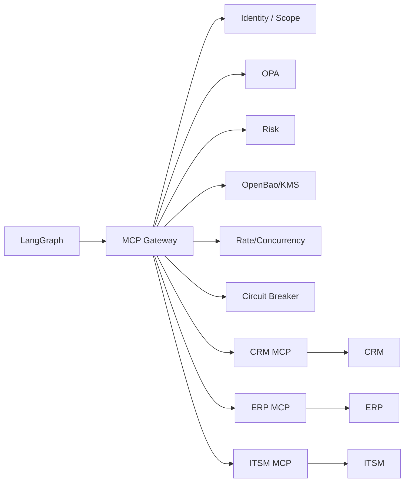

# Digital Employee Platform — Arquitectura de Integración MCP

**Versión:** 0.1.0  
**Estado:** Normativa  
**Creado:** 2026-09-21  
**Actualizado:** 2026-10-19

## 1. Propósito

MCP es el protocolo preferido para exponer capacidades empresariales a los Empleados Digitales. Proporciona una interfaz de herramienta consistente, mientras que la plataforma conserva la responsabilidad por la seguridad, la gobernanza y la ejecución.

## 2. MCP no es autorización

La existencia de una herramienta MCP no significa que un empleado pueda usarla. La autorización ocurre en las capas de identidad, política y gateway de la plataforma.

## 3. Arquitectura



## 4. Responsabilidades del MCP Gateway

- autenticar al llamador;
- autorizar la capacidad;
- validar esquemas;
- normalizar argumentos;
- evaluar la política;
- evaluar el riesgo;
- hacer cumplir la aprobación;
- resolver credenciales;
- aplicar límites de peticiones/concurrencia;
- aplicar cortacircuitos (circuit breaker);
- hacer cumplir timeouts/reintentos;
- adjuntar idempotencia;
- auditar la invocación;
- emitir telemetría;
- validar resultados.

## 5. Registro de herramientas

Cada herramienta debería tener metadatos:

```yaml
name: crm.create_case
version: 1
risk: MEDIUM
side_effect: MUTATING
idempotent: true
required_scopes:
  - crm.case.write
classification_impact: CONFIDENTIAL
```

## 6. Categorías de herramientas

- consulta de solo lectura.
- análisis/cálculo derivado.
- generación de borradores.
- operación de mutación.
- operación destructiva.
- transacción financiera.

El riesgo y los requisitos de aprobación deberían normalmente aumentar con la gravedad del efecto secundario.

## 7. Menor privilegio

Un Empleado Digital recibe únicamente las herramientas requeridas para sus tareas. Una tarea puede restringir aún más las herramientas dentro de la concesión más amplia del empleado.

## 8. Aislamiento de credenciales

El MCP Gateway resuelve la credencial asociada a la integración y al scope. El modelo nunca recibe la credencial en bruto.

Los modos de exposición (intermediado, inyectado, deshabilitado) y sus requisitos están definidos en `06` §7.1. El gateway es el mediador preferido: para integraciones confidenciales la credencial no debería llegar al ejecutor en absoluto.

## 8.1 Conectores con identidad de usuario (en nombre de una persona)

*Agregado 2026-10-19 — cierra el hallazgo K-29 de `docs/reference/KORTIX-CROSS-MATRIX.md`.*

Existen dos tipos de credenciales y no deben confundirse:

| Tipo | Representa | Uso típico |
|---|---|---|
| **Credencial de servicio** | A la integración misma (cuenta de servicio de la plataforma o de la empresa) | Leer un CRM, abrir un ticket, consultar monitoreo |
| **Credencial delegada de usuario** | A una persona concreta, con sus propios permisos | El empleado escribe un correo "como" su responsable, lee la agenda de esa persona, actúa en una herramienta cuyo modelo es por usuario |

Para conectores delegados a usuario la plataforma debe definir:

- un flujo explícito de **consentimiento** por usuario y por conector, registrado y auditable;
- **alcance**: el empleado puede actuar como esa persona solo para tareas que esa persona está autorizada a realizar; el conjunto efectivo es la intersección de los permisos del usuario, los permisos del empleado y la política;
- **ciclo de vida del token**: tokens de vida corta con refresh, un responsable a cargo de la revocación y revocación automática cuando la persona causa baja (`06` §2.1);
- **auditoría**: una acción delegada registra ambas identidades (el empleado y la persona en cuyo nombre actuó);
- **semántica de falla**: una delegación vencida o revocada produce un error tipado no reintentable que se muestra como acción bloqueada — nunca un fallback silencioso a una credencial de servicio;
- **prohibición**: las credenciales personales de una persona (su contraseña, su API key personal) nunca se almacenan; solo concesiones delegadas y revocables al estilo OAuth.

## 9. Límite de peticiones

Los límites pueden definirse por:

- tenant;
- empleado;
- tarea;
- herramienta;
- servidor MCP;
- sistema externo.

Los límites de concurrencia son particularmente importantes para sistemas heredados que no pueden manejar de forma segura un paralelismo alto.

## 10. Cortacircuitos (circuit breaker)

Cada integración debería tener un estado de circuito independiente. Los fallos repetidos provocan un estado abierto temporal y reintentos de recuperación controlados.

## 11. Reglas de reintento

Los reintentos solo son automáticos para errores transitorios clasificados. Los errores de validación de negocio y los fallos de autorización no se reintentan a ciegas.

## 12. Idempotencia

Las herramientas de mutación deberían exponer semántica de idempotencia siempre que sea posible. Si el sistema subyacente no soporta idempotencia, el gateway o el adaptador de integración debe documentar su mitigación.

## 13. Confianza en los servidores MCP

Los servidores MCP son código externo y deben tratarse como componentes de integración privilegiados. La incorporación en producción debería incluir propiedad, fuente, versión, scopes, destinos de red, requisitos de secretos y revisión de seguridad.

## 14. Validación de salida de herramientas

La salida de la herramienta son datos no confiables. Valide contra el esquema declarado y los límites de tamaño. No ejecute instrucciones encontradas en la salida de la herramienta.

## 15. Versionado

Los esquemas de herramienta y las configuraciones de servidor MCP están versionados. Una Ejecución registra las versiones utilizadas.

## 16. Modos de fallo

La plataforma distingue:

- timeout;
- fallo de autenticación;
- denegación de autorización;
- límite de peticiones;
- circuito abierto;
- error del proveedor;
- violación de esquema;
- rechazo de negocio;
- error desconocido.

## 17. Observabilidad

Cada invocación emite métricas y logs estructurados con identificadores de ejecución/herramienta. Los argumentos sensibles se redactan o se representan mediante hashes/referencias.

## 18. Evolución futura

A mayor escala, el gateway puede dividirse en servicios de aplicación de políticas sin estado (stateless) o integrarse con una capa de API gateway/proxy. El contrato lógico permanece sin cambios.
